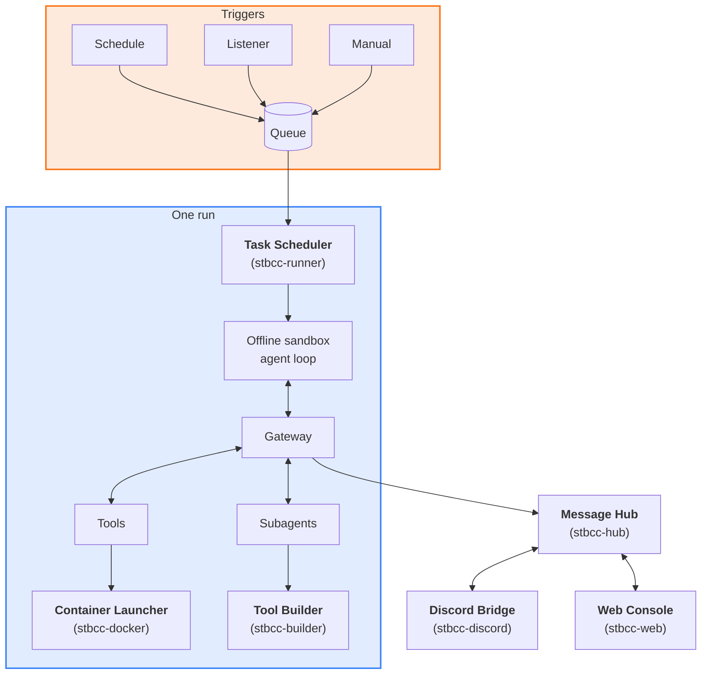

<div align="center">
  
  <h1>sparky-toolbox</h1>

  <p><b>A personal agent harness built for the NVIDIA DGX Spark.</b></p>
</div>

---

## Highlights

- **Extends itself** — builds and ships its own new tools after you approve.
- **Local models, one at a time** — queued, prioritized, swapped on demand.
- **Prompt-injection aware** — untrusted content is read in isolation.
- **Functions and MCP tools** — light built-in functions run in the sandbox; MCP tools load on demand.
- **Skills** — drop in Agent Skills; dependencies install themselves.
- **Two task modes** — an agent that plans its own steps, or a workflow of fixed steps.

## How it works



- The sandbox is an offline container with an unprivileged agent; every tool call passes through the gateway, which enforces budgets, hooks and approvals.
- Tools are MCP servers running as a restricted user. The schema sent to the model never changes; on-demand tools are registered up front and loaded by name.
- Tools never start containers themselves; the launcher starts them within the limits each tool declares.

## Layout

```
control_center/   platform core: queue and scheduler, per-run gateway, message hub, sandbox, web console
  builder/        self-extension: approved plans, isolated dev areas, verify runs against current main, trials and deploys
  tools/          platform built-ins: file and shell functions inside the sandbox, the on-demand tool loader
  schema/         the single source of truth for every YAML field, locked by an approved fingerprint
tools/            one folder per tool: tool.yaml, an MCP server, an optional usage guide and requirements;
                  discovered at runtime, run as a restricted user with network limits declared per tool
subagents/        one folder per subagent: agent, generator or engine, each with its own model, prompt and tool set
skills/           your own Agent Skills: SKILL.md plus scripts and references, read-only inside the sandbox
channels/         pluggable chat entry points: each one registers with the hub over a local socket at startup
services/         container images and service units; tool containers are started through the launcher within declared limits
config/           platform settings and model profiles
tasks/            your own tasks
```

## What it believes

**Context is scarce.** The model carries only what the current job needs. Tools outside the core set appear as a one-line catalog entry; loading one returns its usage guide and a compact signature. The tool schema sent to the model never changes, so the prefix cache keeps hitting even as tools are loaded mid-run. Loaded tools and skills are re-attached after context compaction and carry over to the next message in a chat, so the model never has to load the same thing twice.

**Keep the model from doing dumb things.** The agent runs in an offline container as an unprivileged user, and every tool call passes through a gateway that enforces budgets, hooks and approvals. Anything that reaches the outside world goes through a tool, and anything irreversible waits for an approval card on a connected chat channel. Mail, web pages and attachments are read by isolated subagents that answer specific questions with verified quotes, so instructions hidden in them never reach the main model. The platform, not the model, holds the keys.

**Serial by design.** A single box can hold one large model at a time. Jobs are queued by priority and run one after another; the scheduler loads the model a job names, unloads whatever is in the way, and lets urgent work preempt background work at a safe boundary. Nothing competes for memory, and nothing steps on anything else.

**Highly extensible.** Tools, tasks, subagents and skills are self-contained folders discovered at runtime; nothing is hardcoded and there is no allowlist to maintain. Extend it by hand by dropping a folder in, or let it extend itself: the agent hands a missing ability to the builder subagent, which drafts a plan for a new tool, task or subagent, and once the plan is approved, develops it in an isolated dev area, runs the full test suite and a trial in the real environment, and ships it.

## Quickstart

**You need:**

- Linux with systemd and kernel 6.7+ for Landlock (Ubuntu 24.04's 6.8 works; the shell tool's read-only mode needs 6.12+);
- a user that can run `sudo` (the installer uses it for the root steps);
- Docker with your user in the `docker` group. On Ubuntu: `sudo apt install docker.io && sudo usermod -aG docker $USER`, then log out and back in;
- Python 3.12, [uv](https://docs.astral.sh/uv/), `acl`, `bc` and `git`;
- about 2 GB of free RAM for the platform itself (its services take about 250 MB, a sandboxed run stays under 1 GB);
- a model behind an OpenAI-compatible API: a local [vLLM](https://github.com/vllm-project/vllm) or [Ollama](https://ollama.com), or a hosted endpoint with an API key. A GPU is only needed for whatever serves your model.

```bash
git clone https://github.com/joyzhang14-14/Sparky-toolbox.git sparky-toolbox && cd sparky-toolbox
./install.sh
```

The installer checks the prerequisites, then lists every step that needs root and asks before running it:

- a tool user and a shared group (`sparky` / `sparkle` by default; set `tool_user` / `shared_group` in `config/stbcc.yaml` to change them);
- a sudo rule that lets you run commands as the tool user;
- directory permissions;
- `loginctl enable-linger`.

It then creates `.venv`, `.env` and the sandbox image, and installs the scheduler, message hub, web console and daily cleanup as systemd user services. If it says a group has not taken effect yet, log out of every session, run `sudo systemctl restart user@$(id -u).service` (or reboot), log back in and run `./install.sh` once more; it skips whatever is already done.

**Point it at your model.** `config/models.yaml` ships with the profiles of the original machine. Replace them with your own, following `config/models.example.yaml` (local vLLM, Ollama, hosted endpoint). Put API keys in `.env` and reference them by name with `api_key`. A profile without `start` / `stop` is treated as always on.

**Write and run your first task.**

```bash
export PATH="$PWD/.venv/bin:$PATH"
stb doctor --smoke                       # sandbox image, network, services
```

Create `tasks/hello/task.yaml`, with `runtime` / `model` set to a profile's `runtime` / `model_path` in `config/models.yaml` (not the id from `/models`):

```yaml
name: hello
description: Write hello.txt in the working directory and reply in one sentence
enabled: true
trigger: manual
timeout: 5m
runtime: vllm
model: Qwen/Qwen3-8B
tools:
  - workspace                # read and write this task's working directory
system_prompt: |
  This is an install test. In the working directory, write a file hello.txt containing one line: "hello from stb" followed by the current date and time.
  Read it back to check, then answer in one sentence: which file you wrote and what is in it.
```

```bash
stb task check tasks/hello/task.yaml
stb task add tasks/hello/task.yaml
stb run hello --now --wait
stb logs hello
```

Run records land in `logs/runs/hello/`. The task's files go to its working directory, `<tool user home>/workspace/hello/` by default. The web console listens on port 18090.

The platform was written for its author’s own use, so the prompts and system messages call the owner "Joy" and the assistant "Sparky"; this does not affect how anything works.

**Optional components**, each turned on with an `./install.sh` flag:

- `--discord`: the Discord bridge, for chatting and approval cards;
- `--docker`: the container launcher, for tools that run in containers;
- `--builder`: the builder, which extends the system itself;
- `--owa`: web research;
- `--comfyui`: image and video generation through your own ComfyUI.

Recommended: [Tailscale](https://tailscale.com). The web console binds to the Tailscale address when there is one and to `127.0.0.1` otherwise, so it stays off the public internet.

## Credits

- **[Claude Code](https://www.anthropic.com/claude-code)** — the way of working this harness learned from.
- **[pi coding agent](https://github.com/badlogic/pi-mono)** — the agent loop inside the sandbox.
- **[Model Context Protocol](https://modelcontextprotocol.io)** — how every tool plugs in.
- **[vLLM](https://github.com/vllm-project/vllm)** · **[ComfyUI](https://github.com/comfyanonymous/ComfyUI)** — local models for text, images and video.
- **[BAAI/bge-m3](https://huggingface.co/BAAI/bge-m3)** · **[micromamba](https://github.com/mamba-org/mamba)** — semantic search and the sandbox package environment.
- **[Hermes Agent](https://github.com/NousResearch/hermes-agent)** — the memory threat patterns (`control_center/threat_patterns.py`), ported under the MIT License (see THIRD_PARTY_NOTICES.md).

## License

MIT — see [LICENSE](LICENSE).
